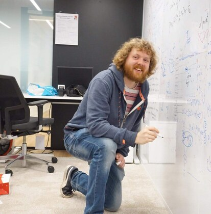
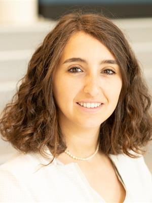
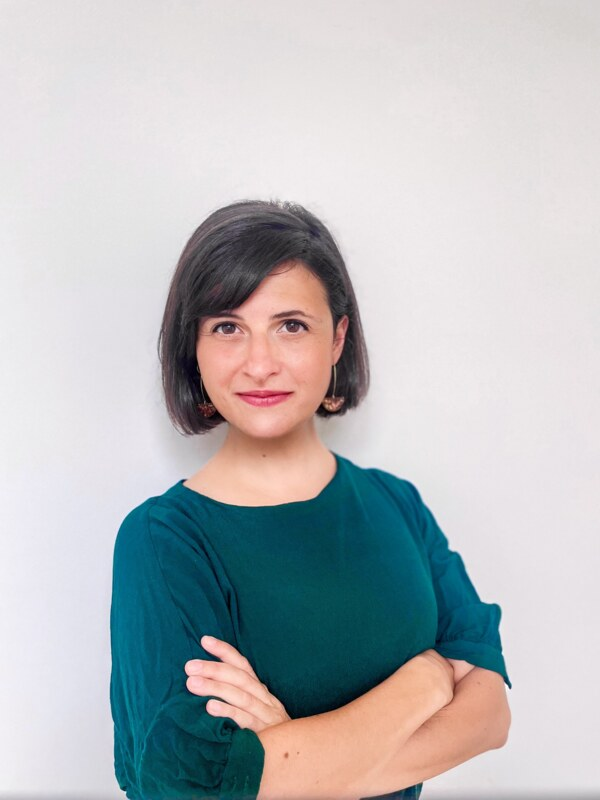
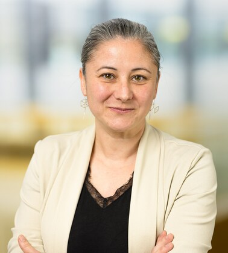

::: {.project-kicker}
People behind the community
:::

#  {#page-title}

::: {.project-intro}
Connecting teachers across faculties to strengthen machine learning education together.
:::

:::: {.community-content}
## Join the conversation

Receive invitations through the mailing list, join the community's Teams space, or come along to a get-together. You can also contact us with a teaching question, a talk proposal, or an idea for collaboration.

::: {.action-links}
[Join the mailing list](https://listserv.tudelft.nl/mailman/listinfo/ml-teaching-community){.btn .btn-primary}
[Join MS Teams](https://teams.microsoft.com/dl/launcher/launcher.html?url=%2F_%23%2Fl%2Fteam%2F19%3AVo-uiCGHkC7vgBQABPovcoBMotEe1is3GfYVHUsIc181%40thread.tacv2%2Fconversations%3FgroupId%3D6b26f97c-f420-4628-90d2-af671a93e875%26tenantId%3D096e524d-6929-4030-8cd3-8ab42de0887b&type=team&deeplinkId=0c1e94f4-40e3-4ad4-ba01-747cfe8ae260&directDl=true&msLaunch=true&enableMobilePage=true&suppressPrompt=true){.btn .btn-outline-primary}
:::

**General contact:** [ml-teaching-community@tudelft.nl](mailto:ml-teaching-community@tudelft.nl)

## Community team {#community-team}

Meet the people leading the community's activities.

### CAIT

Shared teaching resources · Led by **Tom Viering and Bianca Giovanardi**

```{=html}
<ul class="community-role-people" aria-label="CAIT leads">
<li><a href="cait.html#initiative-leads"><span>Tom Viering</span></a><a class="person-contact" href="mailto:T.J.Viering@tudelft.nl">Email Tom</a></li>
<li><a href="cait.html#initiative-leads"><span>Bianca Giovanardi</span></a><a class="person-contact" href="mailto:B.Giovanardi@tudelft.nl">Email Bianca</a></li>
</ul>
```

[Explore CAIT and its contributors](cait.qmd)

### Events

Community get-togethers · Led by **Elena Congeduti**

```{=html}
<ul class="community-role-people" aria-label="Events lead">
<li><a href="events.html"><span>Elena Congeduti</span></a><a class="person-contact" href="mailto:e.congeduti@tudelft.nl">Email Elena</a></li>
</ul>
```

[See upcoming and past gatherings](events.qmd)

### Research & Innovation

Research and educational innovation · Led by **Gosia Migut**

```{=html}
<ul class="community-role-people" aria-label="Research and Innovation lead">
<li><a href="research-innovation.html"><span>Gosia Migut</span></a><a class="person-contact" href="mailto:M.A.Migut@tudelft.nl">Email Gosia</a></li>
</ul>
```

[Explore the projects](research-innovation.qmd)

**AI Education Development:** Wendy Jansen, project leader · [W.K.K.Jansen@tudelft.nl](mailto:W.K.K.Jansen@tudelft.nl)

## Read more

- [The community on the TU Delft website](https://www.tudelft.nl/ai/onderwijs/ai-onderwijsinnovatie/machine-learning-teachers-community)
- [AI educational innovation at TU Delft](https://www.tudelft.nl/en/ai/education/ai-educational-innovation)
- [Community updates on LinkedIn](https://www.linkedin.com/company/146490082/)
::::
