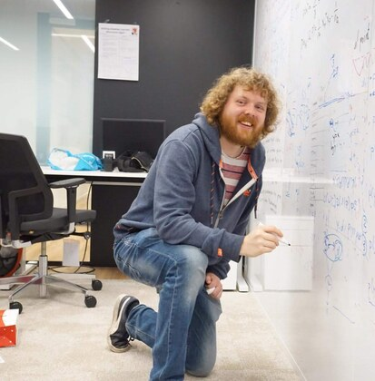
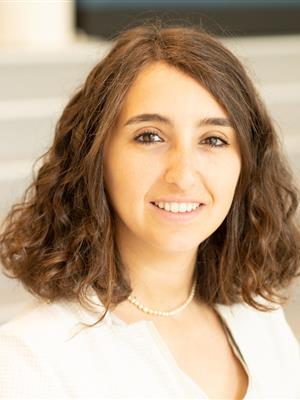
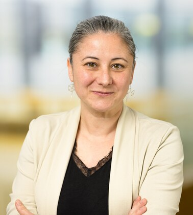
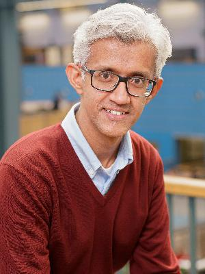
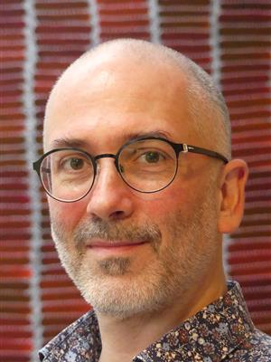
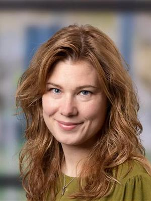
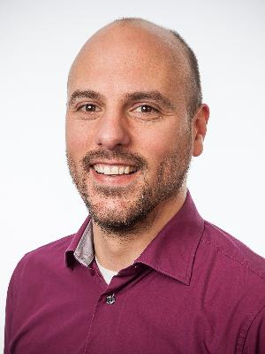
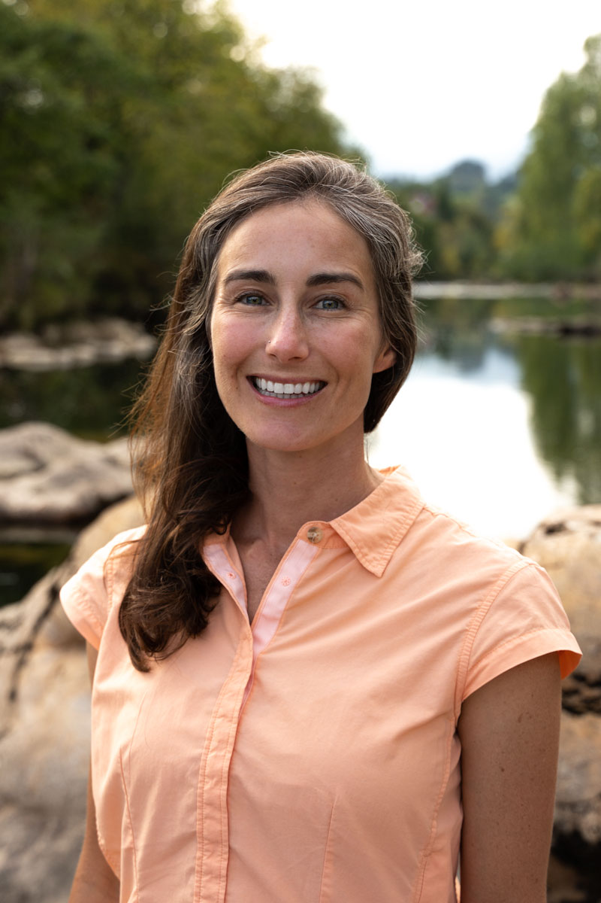

::: {.project-kicker}
Share teaching resources
:::

#  {#page-title}

::: {.project-intro}
Community Archive for Integrated Teaching: a shared home for materials that help us teach AI and machine learning.
:::

:::: {.community-content}
## Build on each other's teaching

CAIT helps teachers discover and exchange educational materials. Its purpose is to make useful resources easier to find, adapt, and improve together, across courses and disciplines.

::: {.action-links}
[Explore CAIT](https://cait.tudelft.nl/){.btn .btn-primary}
[Contact the CAIT team](mailto:cait-ewi@tudelft.nl){.btn .btn-outline-primary}
:::

## Find, adapt, contribute

- **Find a good fit.** Resource descriptions help teachers judge the intended audience, prerequisites, and learning goals.
- **Reuse and combine.** Collections called circuits connect materials into teaching sequences.
- **Share experience.** Comments, feedback, and usage information help the community improve resources.
- **Contribute materials.** Bring an activity, example, or teaching resource to the team and discuss how others could use it.

## Leading the initiative {#initiative-leads}

**Tom Viering and Bianca Giovanardi lead CAIT**, bringing together educators and student developers to build a shared platform for teaching materials.

```{=html}
<ul class="initiative-leads" aria-label="CAIT initiative leads">
<li class="initiative-person"><a href="https://tomviering.nl/"><span class="person-name">Tom Viering</span></a><span class="person-role">Initiative lead</span><span class="person-affiliation">EEMCS · Intelligent Systems</span></li>
<li class="initiative-person"><a href="https://www.tudelft.nl/en/staff/b.giovanardi/"><span class="person-name">Bianca Giovanardi</span></a><span class="person-role">Initiative lead</span><span class="person-affiliation">Aerospace Engineering · Aerospace Structures &amp; Materials</span></li>
</ul>
```

## Developed with the community {#cait-contributors}

CAIT grew from the Machine Learning Teachers Community into a working group spanning faculties and institutions. The student team **Praxidike** built the first platform during TU Delft's CSE2000 Software Project course in summer 2024.

Alongside Bianca and Tom, the June 2026 presentation acknowledged the following colleagues' contributions:

```{=html}
<ul class="initiative-contributors" aria-label="CAIT contributors">
<li class="initiative-person"><a href="https://gosiamigut.github.io/"><span class="person-name">Gosia Migut</span></a></li>
<li class="initiative-person"><a href="https://www.tudelft.nl/en/ide/about-ide/people/colombo-s"><span class="person-name">Sara Colombo</span></a></li>
<li class="initiative-person"><a href="https://www.tudelft.nl/en/ide/about-ide/people/chandrasegaran-rsk"><span class="person-name">Senthil Chandrasegaran</span></a></li>
<li class="initiative-person"><a href="https://www.tudelft.nl/io/over-io/personen/murray-rust-d"><span class="person-name">Dave Murray-Rust</span></a></li>
<li class="initiative-person"><a href="https://www.tudelft.nl/en/staff/i.lefter/"><span class="person-name">Iulia Lefter</span></a></li>
<li class="initiative-person"><a href="https://www.tudelft.nl/staff/m.klomp/"><span class="person-name">Martin Klomp</span></a></li>
<li class="initiative-person"><a href="https://www.tudelft.nl/open-science/about/organisation"><span class="person-name">Paige Folsom</span></a></li>
</ul>
```

::: {.source-note}
Portraits: TU Delft and the contributors' professional websites. Select a name or photo to visit the source profile. [June 2026 presentation (PDF)](https://filelist.tudelft.nl/Websections/AIDU/AI%20website%20%E2%80%93%20Education/CAIT_MLGetTogether.pdf) · [CAIT's story](https://cait.beta.praxidike.org/about)
:::

## Support for CAIT {#cait-support}

Bianca Giovanardi and Tom Viering's CAIT project received support from the **Mainstream Open Science Fund 2024–2025**. CAIT also acknowledges funding from **Convergence**. The **Education Fellowship 2026 awarded to Gosia Migut and Tom Viering** supports the next steps for the wider teaching community and the expansion of CAIT.

[Open Science award](https://www.tudelft.nl/en/open-science/community/mainstream-open-science-fund-2024-2025-2) · [Education Fellowship](https://www.tudelft.nl/en/2025/eemcs/three-eemcs-professors-receive-tu-delft-education-fellowship-2026) · [Funding update on the blog](community-blog.qmd#cait-funding-update)

At the internal launch on **4 June 2026**, a wider launch was envisaged for the 2026–2027 academic year. Contact the team for current access and contribution arrangements.

## Teaching materials as a shared resource

A TU Delft interview with Tom Viering places CAIT within a broader commitment to open research and reusable teaching materials. Shared resources can help teachers spend more time improving learning activities and less time rebuilding similar material.

[Read the TU Delft update on LinkedIn](https://www.linkedin.com/posts/tudelft_university-technology-innovation-activity-7471068639903854593-P74m)
::::
