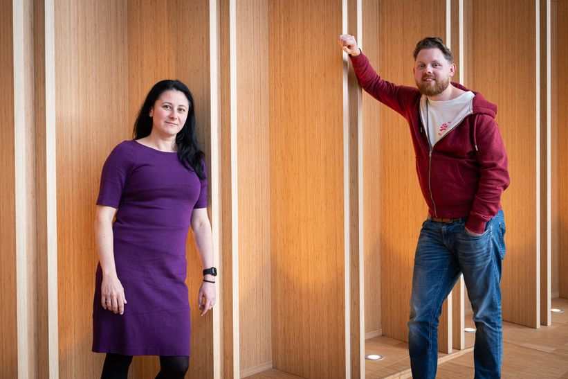
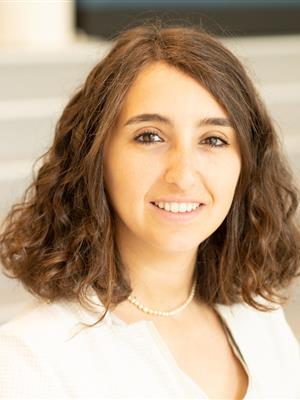
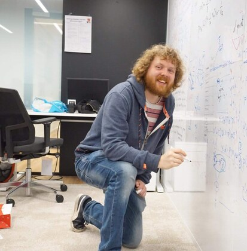
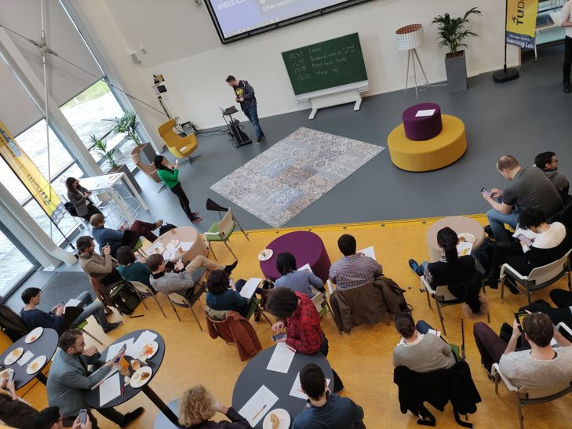
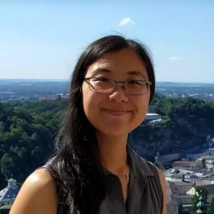
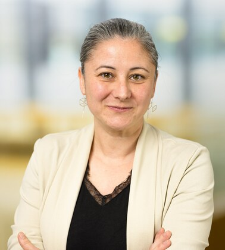
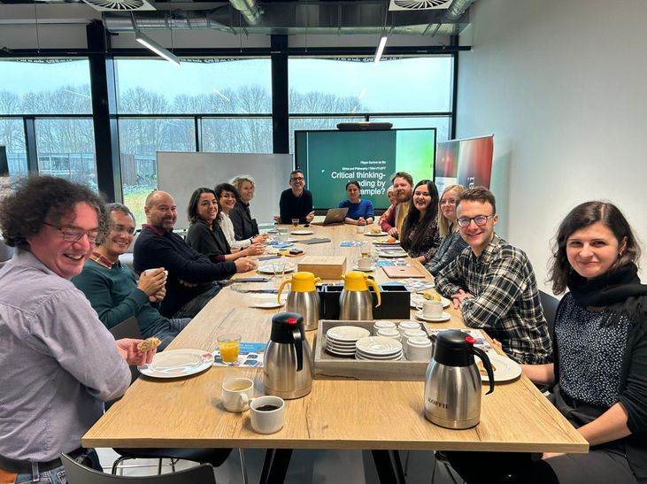

::: {.project-kicker}
Ideas from our community
:::

#  {#page-title}

::: {.project-intro}
Short reads, teaching reflections, and links to stories from our community.
:::

:::::: {.story-list}
::::: {.story-card}
:::: {.story-image}
```{=html}
<div class="story-date-badge"><time datetime="2026-11-05"><span>5 November</span><strong>2026</strong></time><span>Education Day</span></div>
```
::::
:::: {.story-copy}
::: {.story-meta}
5 November 2026 · Community recognition
:::

## TU Delft Education Team of the Year 2026 {#education-team-of-the-year-2026}

**Practical AI in Engineering received TU Delft's Education Team of the Year award**, celebrated at Education Day on **5 November 2026**.

The Teaching Academy recognised the collaboration across EEMCS, Aerospace Engineering, and Technology, Policy and Management. Its announcement highlighted the combination of technical AI learning, ethical reasoning, and authentic engineering challenges—and the team's ambition to build reusable resources that benefit education beyond a single course.

<details class="recognition-team">
<summary>The recognised team</summary>

Bahareh Abdi, Martin Sand, Tom Viering, Dario Turelli, Gosia Migut, Junzi Sun, Behdad Etezadi, Oskar Lang Moesmand, Alireza Saghaeian, Thom van den Hil, and Vasko Dakov.

</details>

[Teaching Academy announcement on LinkedIn](https://nl.linkedin.com/company/tu-delft-teaching-academy) · [Education Day 2026](https://www.tudelft.nl/en/tu-delft-teaching-academy/events/education-day-2026/tu-delft-education-day-2026)
::::
:::::

::::: {.story-card}
:::: {.story-image}
{.founders-story fig-alt="Community founders Gosia Migut and Tom Viering"}
::::
:::: {.story-copy}
::: {.story-meta}
TU Delft · Community interview
:::

## A community built around teaching {#a-community-built-around-teaching}

Founded in 2023 by **Gosia Migut and Tom Viering**, the Machine Learning Teachers Community brings together colleagues who teach ML and AI at TU Delft. Teachers from every faculty are welcome.

We exchange classroom experiences, discuss educational questions, and connect colleagues working on related challenges. A shared interest in open teaching resources has also led to collaboration on [CAIT](cait.qmd), helping teachers build on existing materials across courses.

[Read the interview about machine learning education (PDF)](https://filelist.tudelft.nl/Websections/AIDU/Documents/Article%20Machine%20Learning%20Teachers.pdf)
::::
:::::

::::: {.story-card}
:::: {.story-image}
```{=html}
<div class="story-portraits story-portraits-pair">
  
  
</div>
<div class="story-portrait-caption">CAIT initiative leads: Bianca Giovanardi and Tom Viering.</div>
```
::::
:::: {.story-copy}
::: {.story-meta}
CAIT · Funding update
:::

## Support for open, collaborative teaching {#cait-funding-update}

**Bianca Giovanardi and Tom Viering received support for CAIT through TU Delft's Mainstream Open Science Fund 2024–2025.** The funded work develops a platform where educators can share and improve teaching materials together. CAIT also acknowledges support from Convergence.

::: {.editorial-note}
**More from the team soon.** A fuller account of the grants, their impact, and the next steps for CAIT will be added when Tom and Bianca provide their update.
:::

[Open Science funding announcement](https://www.tudelft.nl/en/open-science/community/mainstream-open-science-fund-2024-2025-2) · [Meet the CAIT team](cait.qmd#initiative-leads)
::::
:::::

::::: {.story-card}
:::: {.story-image}
{fig-alt="Teachers exchanging ideas at a community get-together; archive photograph"}
::::
:::: {.story-copy}
::: {.story-meta}
1 October 2026 · Community gathering
:::

## Three questions for ML teachers

What mathematics do students need? Which concepts change their understanding of ML? And should teaching begin with models or applications? October's gathering brought these questions together through contributions from Matias Valdenegro Toro, Gosia Migut, Jesse Krijthe, and Ilinca Rențea.

[Explore the studies and slides](research-innovation.qmd)
::::
:::::

::::: {.story-card}
:::: {.story-image}
```{=html}
<div class="story-portraits">
  
  
  
</div>
<div class="story-portrait-caption">Authors: Lisa Zhang, Gosia Migut, and Jesse Krijthe.</div>
```
::::
:::: {.story-copy}
::: {.story-meta}
ITiCSE 2026 · Reading recommendation
:::

## When a concept changes the bigger picture

Lisa Zhang, Gosia Migut, and Jesse Krijthe's work on threshold concepts offers a starting point for discussing the ideas students need to see ML as a connected subject. The authors' accompanying blog is linked from the TU Delft community page.

[Read the authors' blog](https://www.cs.toronto.edu/~lczhang/iticse2026/blog.html) · [View their presentation](https://filelist.tudelft.nl/Websections/AIDU/Website%20ML%20Teachers%20Community/Documents/lunch1Oct26_GosiaJesse.pdf)
::::
:::::

::::: {.story-card}
:::: {.story-image}
{.portrait-story fig-alt="Portrait of Tom Viering"}
::::
:::: {.story-copy}
::: {.story-meta}
TU Delft on LinkedIn · Interview
:::

## Making teaching resources easier to share

TU Delft's interview with Tom Viering introduces CAIT alongside his work on data-efficient learning and open research. For teachers, the practical question is how to find material that fits a course—and make their own resources useful to colleagues.

[Read the original LinkedIn update](https://www.linkedin.com/posts/tudelft_university-technology-innovation-activity-7471068639903854593-P74m) · [Discover CAIT](cait.qmd)
::::
:::::

::::: {.story-card}
:::: {.story-image}
{fig-alt="Teachers gathered around a table for the December 2023 discussion on critical thinking"}
::::
:::: {.story-copy}
::: {.story-meta}
19 December 2023 · TU Delft | AI recap
:::

## Critical thinking belongs in ML education

A discussion with Filippo Santoni de Sio explored teachers' role in helping students examine the ethical and political dimensions of AI. Colleagues shared practical teaching experiences and considered how critical thinking can become part of ML education.

[Read the original LinkedIn recap](https://www.linkedin.com/posts/tudelftai_ai-machinelearning-education-activity-7143223531525345281-2c8W)
::::
:::::
::::::

::: {.join-strip}
Follow the [community on LinkedIn](https://www.linkedin.com/company/146490082/) for more updates, or [email us](mailto:ml-teaching-community@tudelft.nl) to suggest a story.
:::
