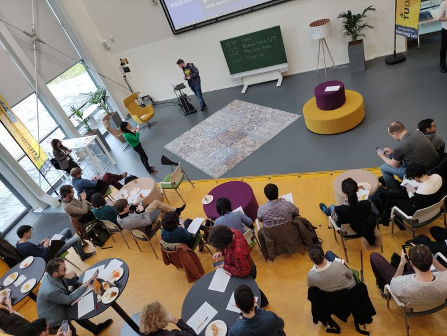

::::: {.community-hero}
:::: {.hero-copy}
#  {#page-title}

::: {.project-intro}
Teaching machine learning is something we can learn together. Meet colleagues across TU Delft, exchange experiences, and bring new ideas into your classroom.
:::

::: {.action-links}
[Join the community](https://listserv.tudelft.nl/mailman/listinfo/ml-teaching-community){.btn .btn-primary}
:::
::::

:::: {.hero-photo}
{fig-alt="Teachers sharing ideas at a gathering in the Teaching Lab"}
::::
:::::
