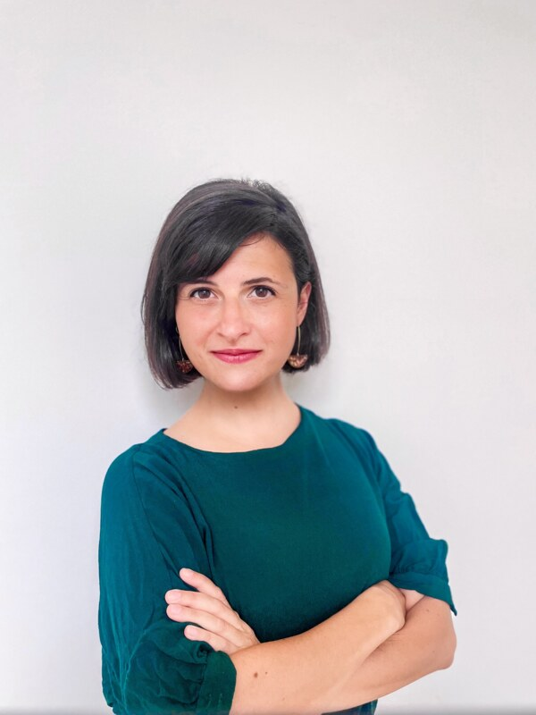
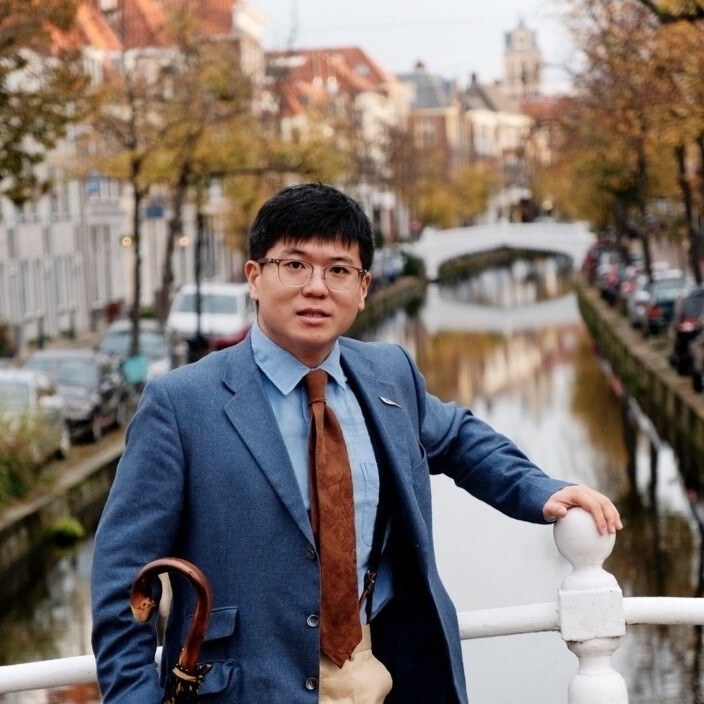
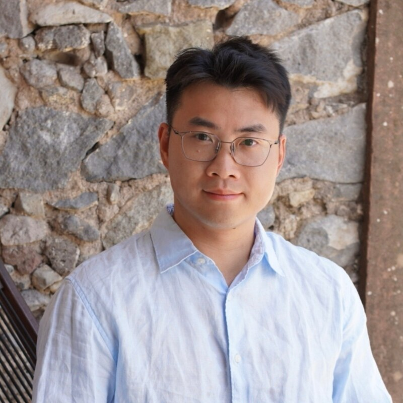
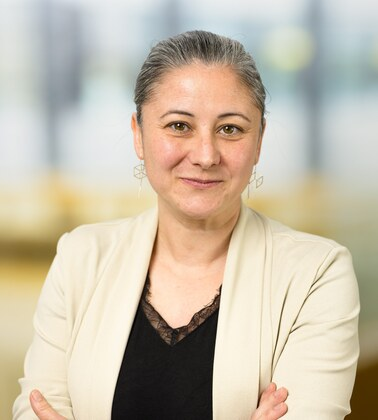
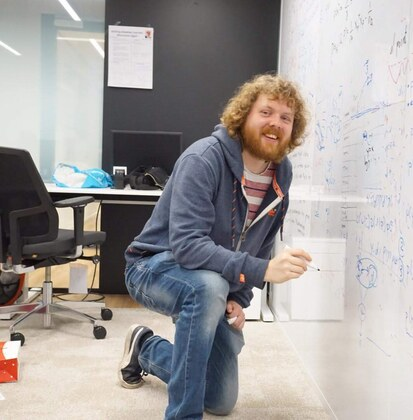
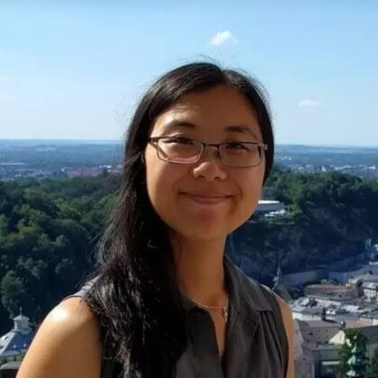

::: {.project-kicker}
Our projects
:::

#  {#micro-grant-projects}

::: {.project-intro}
Small projects that help teachers develop, test, and share new approaches to machine learning education.
:::

The community's micro-grants support educational experimentation and collaboration across courses and disciplines. Explore the projects and the people behind them below.

:::::: {.grant-project}

::: {.project-kicker}
Project 01
:::

## Active Guided Lab Sessions to Improve Code Understanding in ML/AI Courses {.grant-title #project-01}

::: {.project-intro}
Helping students reason about code through guided, hands-on lab work.
:::

::::: {.project-layout}

:::: {.lead-profile}

{.lead-photo fig-alt="Portrait of Elena Congeduti supplied with the project description"}

::: {.lead-label}
Project lead
:::

::: {.lead-name}
Elena Congeduti
:::

::: {.lead-affiliation}
EEMCS, TU Delft
:::

::::

:::: {.project-description}

### About the project {.description-title #project-01-about}

With LLM-generated solutions readily available, students can be drawn to reading solutions instead of writing code themselves. This may create an impression of understanding without the reasoning and practice that programming competence requires. The project responds to teachers' observations of declining programming performance in ML/AI courses and the limitations of autonomous work with fill-in-the-blank notebooks.

The proposed alternative is a series of Teaching Assistant-led sessions. Students will work through algorithm steps on paper, predict what code will do before running it, debug broken implementations, and write code live while interpreting errors. Templated notebooks and ready-made solutions will not be provided.

A small set of sessions will be piloted, with their effects evaluated through student performance and feedback.

::::

:::::

::::::

:::::: {.grant-project}

::: {.project-kicker}
Project 02
:::

## Green AI Education through an Optimization Competition {.grant-title #project-02}

::: {.project-intro}
A Sustainable AI competition that brings accuracy, speed, and energy efficiency into the same task.
:::

::::: {.project-layout}

:::: {.lead-profile}

{.lead-photo fig-alt="Portrait of Enrique Barba Roque supplied with the project description"}

::: {.lead-label}
Project lead
:::

::: {.lead-name}
Enrique Barba Roque
:::

::::

:::: {.project-description}

### About the project {.description-title #project-02-about}

AI courses often emphasise training models and measuring their effectiveness. Sustainability and energy consumption can receive less attention, despite their importance to the environmental impact of AI development.

This project will organise a Sustainable AI competition. Participants will develop or optimise a model for a given task and assess both its effectiveness and resource consumption. An automated testing framework will measure accuracy, speed, and energy efficiency, encouraging students to explore the trade-offs between them.

The competition aims to make Green AI accessible to students from different disciplines, build a community around sustainable AI, and develop practical skills for future work. The project will also investigate competition-based learning as an approach to teaching AI sustainability. Its materials and testing framework will be made available for future educational and research activities.

::::

:::::

::::::

:::::: {.grant-project}

::: {.project-kicker}
Project 03
:::

## Advanced AI Themes in the Built Environment {.grant-title #project-03}

::: {.project-intro}
Expanding teaching materials on DigiPedia.
:::

::::: {.project-layout}

:::: {.lead-profile}

{.lead-photo fig-alt="Photograph supplied with the DigiPedia project description"}

::: {.lead-label}
Project applicants
:::

::: {.lead-name}
Dr. Nan Bai & Dr. Pei-Yu Wu
:::

::: {.lead-affiliation}
Architecture and the Built Environment (BK), TU Delft
:::

::::

:::: {.project-description}

### About the project {.description-title #project-03-about}

Current graduate ML/AI courses in the Faculty of Architecture and the Built Environment focus primarily on introductory and classical machine learning approaches. The project aims to extend this curriculum with advanced topics relevant to urban and building analytics, including natural language processing, graph neural networks, and agentic AI.

The team will expand [DigiPedia](https://digipedia.tudelft.nl/), TU Delft's initiative for open education, with deep learning and generative AI materials tailored to BK's computational curriculum. These resources will broaden the methods available to students and support interdisciplinary research in the built environment.

::::

:::::

::::::

:::::: {.grant-project}

::: {.project-kicker}
Project 04
:::

## Shared Deep Learning Pre-course for Computer Vision and Robotic Perception {.grant-title #project-04}

::: {.project-intro}
A reusable foundation for students entering courses in visual perception and spatial AI.
:::

::::: {.project-layout}

:::: {.lead-profile}

{.lead-photo fig-alt="Portrait of Jingkun Feng supplied with the project description"}

::: {.lead-label}
Project lead
:::

::: {.lead-name}
Jingkun Feng
:::

::::

:::: {.project-description}

### About the project {.description-title #project-04-about}

Computer vision and robotic perception are increasingly important across engineering, from autonomous systems and human–robot collaboration to infrastructure monitoring, built-environment mapping, and visual inspection. Yet students familiar with general AI and deep learning can still struggle to apply that knowledge to visual perception data, models, and evaluation practices.

This project will develop a lightweight pre-course for students entering domain-specific AI/ML courses involving computer vision, robotic perception, and spatial AI. It will combine short learning materials, code-based tutorials, exercises, and diagnostic tests.

Designed for reuse across faculties, the pre-course will provide a shared foundation before practical sessions and project work. It aims to help students participate more confidently while supporting teachers in adapting computer vision materials to their own engineering domains.

::::

:::::

::::::

:::::: {.grant-project}

::: {.project-kicker}
Project 05
:::

## The Interactive, Multi-level Open Book on Machine Learning {.grant-title #project-05}

::: {.project-intro}
An open, adaptable learning resource for undergraduate engineering students.
:::

::::: {.project-layout}

:::: {.lead-profile}

::: {.lead-label}
Project team
:::

::: {.project-team}

<a href="https://www.tudelft.nl/ai/onderwijs/ai-onderwijsinnovatie/machine-learning-teachers-community">Elena Congeduti</a>

<a href="https://www.jessekrijthe.com/">Jesse Krijthe</a>

<a href="https://gosiamigut.github.io/">Gosia Migut</a>

<a href="https://tomviering.nl/">Tom Viering</a>

<a href="https://www.utm.utoronto.ca/math-cs-stats/people/lisa-zhang">Lisa Zhang</a>

:::

::: {.lead-affiliation}
Elena Congeduti, Jesse Krijthe, Gosia Migut, and Tom Viering: EEMCS, TU Delft.

Lisa Zhang: University of Toronto.
:::

::::

:::: {.project-description}

### About the project {.description-title #project-05-about}

Across ML and deep learning courses, no single resource fits every student. Existing materials can be fragmented, inconsistent in notation and style, or aimed at one particular audience. Teachers already have considerable expertise and teaching material; the challenge is to bring these contributions together into a coherent, interactive resource.

The long-term ambition is an open, personalisable ML book for undergraduate students: mathematically sound, intuitive, and usable across faculties. It will cover established foundations alongside topics that receive less attention in existing resources, such as fairness, Bayes classifiers, reinforcement learning, and LLMs.

This project takes the first steps towards that ambition. The team will develop example chapters and design and validate the book's structure, including a scalable authoring model and layered chapters that can be personalised to different learners.

::::

:::::

::::::

:::::: {.grant-project}

::: {.project-kicker}
Project 06
:::

## More to come {.grant-title #project-06}

::::: {.project-layout}

:::: {.lead-profile}

{.lead-photo fig-alt="Placeholder for the sixth project's lead portrait"}

::::

:::: {.project-description}

### Project details coming soon {.description-title #project-06-about}

The sixth project will be added here when its team and description are available.

::::

:::::

::::::

::: {.join-strip}
For questions about the micro-grant programme, contact [ml-teaching-community@tudelft.nl](mailto:ml-teaching-community@tudelft.nl).
:::
