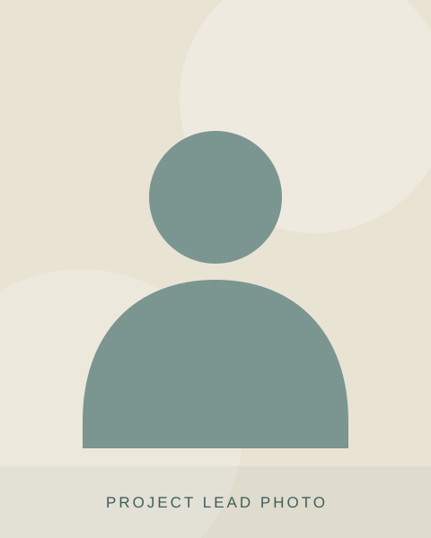

::: {.project-kicker}
Our projects · 05 / 06
:::

#  {#project-title}

::: {.project-intro}
Add one sentence that captures the purpose of this project.
:::

::::: {.project-layout}

:::: {.lead-profile}

{.lead-photo fig-alt="Placeholder for the photograph of project 05's lead"}

::: {.lead-label}
Project lead
:::

::: {.lead-name}
Project lead's name
:::

::: {.lead-affiliation}
Department or organisation
:::

::::

:::: {.project-description}

## About the project

Describe the project here. Introduce the problem or opportunity that motivates the work, and explain why it matters. Keep this opening paragraph accessible to someone encountering the project for the first time.

Explain what the team is doing, who is involved, and how the project addresses the problem. You can include the main activities, research approach, or collaboration with partners.

### What we aim to achieve

- Add the first goal or intended outcome.
- Add the second goal or intended outcome.
- Add the third goal or intended outcome.

### Find out more

Add contact details, a link to a publication, or information about how people can get involved. Delete this section if it is not needed.

::::

:::::

::: {.template-note}
Template content · Replace the project title, portrait, lead details, and description with your own information.
:::

::: {.project-pagination}
[← Project 04](project-04.qmd)

[Project 06 →](project-06.qmd)
:::
